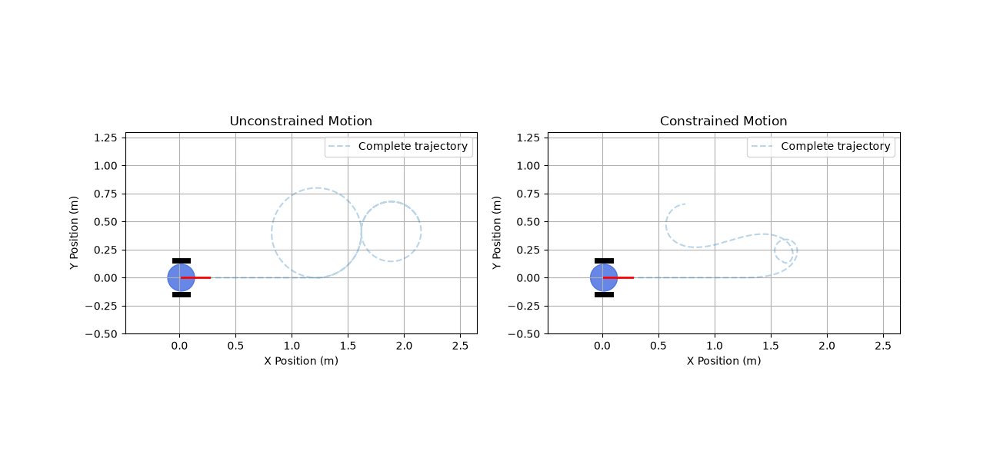

# Differential Drive Robot Kinematics and Velocity Limits

## About the Project

This project is a Python-based simulation of a differential drive mobile robot. The main goal was to understand how a two-wheeled robot moves, how its wheel velocities affect its motion, and how velocity constraints influence its movement.

I implemented the forward and inverse kinematics equations, a robot motion model, and velocity constraints. I also compared the robot's movement with and without these constraints using plots and an animated simulation.

## Features

- Forward kinematics to calculate robot velocity from wheel speeds.
- Inverse kinematics to calculate wheel speeds from desired robot velocity.
- 2D robot motion simulation.
- Linear and angular velocity limiting.
- Angular acceleration limiting.
- Maximum wheel speed enforcement.
- Comparison of constrained and unconstrained motion.
- Trajectory and velocity visualizations.
- Animated robot simulation.

## Technologies Used

- Python 3.13
- NumPy
- Matplotlib
- Pillow

## Project Structure

```text
differential-drive-robot-kinematics/
│
├── robot_parameters.py
├── kinematics.py
├── motion_model.py
├── velocity_constraints.py
├── visualization.py
├── evaluation.py
├── animation.py
├── main.py
│
├── outputs/
├── angular_acceleration_comparison.png
├── angular_acceleration.png
├── angular_velocity_comparison.png
├── angular_velocity.png
├── linear_velocity_comparison.png
├── linear_velocity.png
├── performance_report.json
├── robot_motion_comparison.gif
├── simulation_results.csv
├── trajectory_comparison.png
├── wheel_velocities.png
└── wheel_velocity_comparison.png
│
└── README.md
```

## Kinematics

The robot uses two independently driven wheels. Its movement is controlled by changing the angular velocities of the left and right wheels.

**Forward Kinematics**

Used to calculate the robot's linear and angular velocities from wheel velocities.

\[
v = \frac{v_R+v_L}{2}
\]

\[
\omega = \frac{v_R-v_L}{L}
\]

**Inverse Kinematics**

Used to calculate the required wheel angular velocities from the desired robot velocities.

\[
\omega_R = \frac{v+\frac{\omega L}{2}}{r}
\]

\[
\omega_L = \frac{v-\frac{\omega L}{2}}{r}
\]

Where:
- \(v\): Linear velocity of the robot
- \(\omega\): Angular velocity of the robot
- \(v_R, v_L\): Right and left wheel linear velocities
- \(\omega_R, \omega_L\): Right and left wheel angular velocities
- \(L\): Distance between the wheels
- \(r\): Wheel radius

## Robot Parameters

| Parameter | Value |
|---|---:|
| Wheel radius | 0.05 m |
| Wheelbase | 0.30 m |
| Maximum wheel angular velocity | 10 rad/s |
| Maximum linear velocity | 0.50 m/s |
| Maximum rotational acceleration | 1 rad/s² |

## Simulation: Constrained vs Unconstrained Motion

I ran two simulations using the same velocity commands.

- **Unconstrained simulation:** The robot follows the requested velocities without enforcing the configured limits.
- **Constrained simulation:** The robot follows the same commands while respecting the configured velocity, acceleration, and wheel speed limits.

This comparison helps demonstrate how physical limits affect the robot's trajectory and motion.

## Results and Visualizations

The simulation generates the following plots:

- Robot trajectory comparison
- Linear velocity comparison
- Angular velocity comparison
- Angular acceleration comparison
- Wheel velocity comparison

The numerical results are saved in CSV and JSON formats for further analysis.

## Robot Animation

The project also includes an animated comparison of both simulations.



## Installation and Execution

**1. Clone the repository**

```bash
git clone https://github.com/Himangimaurya/differential-drive-robot-kinematics.git
```

**2. Open the project directory**

```bash
cd differential-drive-robot-kinematics
```

**3. Create a virtual environment**

```bash
python -m venv .venv
```

**4. Activate the environment (Windows)**

```bash
.venv\Scripts\activate
```

**5. Install dependencies**

```bash
python -m pip install numpy matplotlib pillow
```

**6. Run the simulation**

```bash
python main.py
```

**7. Run the animation**

```bash
python animation.py
```

**8. Run the evaluation tests**

```bash
python evaluation.py
```

## Learning Outcomes

Through this project, I explored:

- The mathematical foundation of differential drive robot kinematics.
- The relationship between wheel velocities and robot movement.
- How to implement a basic 2D robot motion model.
- The importance of velocity and acceleration constraints.
- How to visualize and evaluate robot motion using Python.

## Future Improvements

- Implement more accurate numerical integration.
- Add obstacle detection and avoidance.
- Introduce different velocity command profiles.
- Explore integration with ROS 2 and Gazebo.

---

*This project was developed as a hands-on exercise to understand mobile robot kinematics, motion simulation, and velocity constraints using Python.*